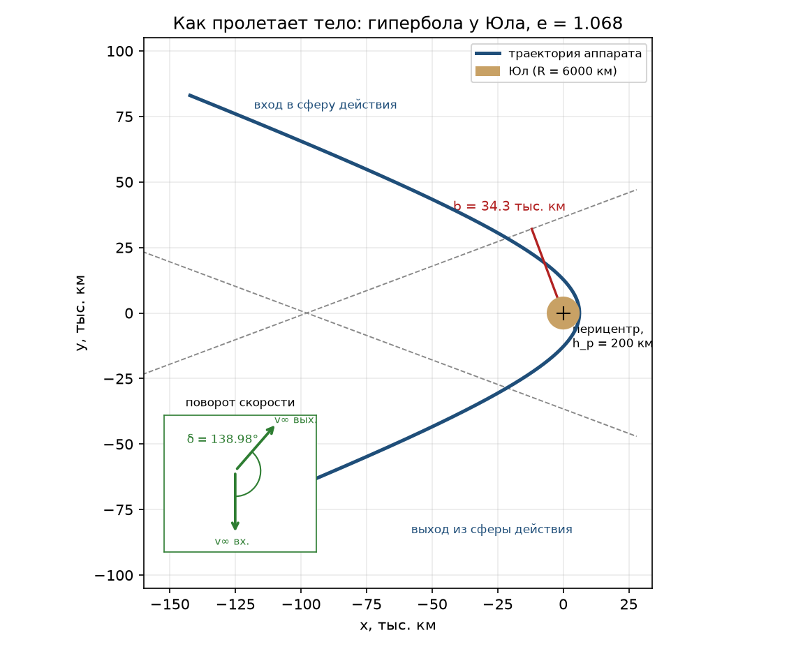

# Пролёт у Юла: расчётно-пояснительная записка на одну неделю

**Что это за документ.** Ядро проекта ВАРКТ'26, переписанное так, чтобы его можно было
сделать и защитить одному за семь дней: физико-математическая модель пролёта, расчёт
на Python, результаты, проверка и объяснение. Условие одно: **программу ты набираешь
руками и понимаешь каждую строку** — тогда это твоя работа, а не чужая.

Дата: 24.11.2026. Сроки: предварительный отчёт — 30.11, финал — 10.12.

---

## 0. За тридцать секунд

| Вопрос | Ответ |
|---|---|
| Что я делаю | Пролёт аппарата у Юла: поворот траектории гравитацией и что из этого следует |
| Чем считаю | `src/hand_flyby.py` — 150 строк на Python, только `math` (+ `matplotlib` для рисунка) |
| Главный результат | δ = 138.98° при h_p = 200 км; пролёт забрасывает на 710 млн км; уйти из системы нельзя — не хватает 25.3°, добирается импульсом 58.9 м/с |
| Что показываю | 5 таблиц + рисунок 8 + работающую программу, которую можно менять на глазах |
| Что не делаю | Перелёт, Ламберт, задача трёх тел, анимация, вёрстка ГОСТ — это готовая часть проекта |
| Сколько времени | 12–15 часов за неделю, подходами по 40–60 минут |

---

## 1. Неделя: что успеваю и что нет

### 1.1 Бюджет времени

После армии главный ресурс — не знания, а **внимание**: длинные подходы не работают,
работают короткие и регулярные. Поэтому режим такой:

- 3 подхода в день по 40–60 минут (утро / день / вечер), между ними — перерыв;
- таймер на 40 минут, после — встать и отойти, даже если «только начал понимать»;
- каждый подход заканчивается **артефактом**: посчитанное число, написанная функция,
  прогнанный скрипт. Не «почитал», а «сделал»;
- один день из семи — разгрузочный (в таблице это суббота: только проговорить вслух);
- никаких ночных подходов: на защите нужен человек, который выспался, а не герой.

### 1.2 План по дням

| День | Что делаю | Время | Чем заканчивается |
|---|---|---|---|
| 24.11 пн | Читаю §2.3–2.5 отчёта, выписываю от руки формулы (2.5), (2.7), (2.8) | 1.5 ч | листок с тремя формулами и обозначениями |
| 25.11 вт | Набираю `hand_flyby.py`, часть 1: `flyby()` и таблицу e, δ, b | 2 ч | скрипт печатает 5 строк таблицы 1 |
| 26.11 ср | Добавляю `post_flyby()`: векторный расчёт, a, e, афелий | 2 ч | таблица 2 совпала с отчётом |
| 27.11 чт | Добавляю обратную задачу, Оберта и геометрию; строю рисунок 8 | 2 ч | полный вывод программы + `fig8_flyby_geometry.png` |
| 28.11 пт | Переписываю §7 и титул под реальный состав; проговор вслух 3 минуты | 2 ч | новый PDF, речь без бумажки |
| 29.11 сб | Разгрузка: 2 прогона защиты, 10 вопросов вслух (без подготовки) | 1 ч | список мест, где плыву |
| 30.11 вс | Сборка PDF, сдача предварительного отчёта | 1 ч | сданный отчёт |

Дальше до 10.12: презентация 10 слайдов по готовым рисункам (5 ч), видео (2 ч),
два полных прогона на 7 минут (3 ч).

### 1.3 Если времени окажется в два раза меньше

Тогда порядок такой — сверху вниз, до первой невыполненной строки:

1. **Уметь вывести δ = 2·arcsin(1/e) и объяснить 4 числа** (2 ч) — это минимум, ниже которого
   защищаться нечем;
2. **Прогнать готовый `hand_flyby.py` и объяснить структуру** (1 ч) — код можно не набирать,
   но каждую функцию надо уметь назвать;
3. §7 и титул (1 ч) — иначе первый вопрос будет не по теме;
4. презентация (3 ч) — по готовым рисункам из `out/`.

---

## 2. Постановка задачи

Аппарат подлетает к Юлу по гомановской траектории с относительной скоростью
`v∞ = 1756 м/с`. Нужно ответить на четыре вопроса:

1. **Насколько сильно гравитация Юла повернёт траекторию?** (угол δ как функция высоты
   перицентра `h_p`.)
2. **Куда после этого полетит аппарат?** (гелиоцентрическая орбита: `a`, `e`, афелий.)
3. **Можно ли так уйти из системы Кербола?** (условие `v_out ≥ v_esc`.)
4. **Если нельзя — сколько стоит недостача?** (импульс Оберта в перицентре.)

### 2.1 Исходные данные (KSP 1.12, stock)

| Величина | Обозначение | Значение |
|---|---|---|
| Гравитационный параметр Кербола | μ☉ | 1.1723328·10¹⁸ м³/с² |
| Гравитационный параметр Юла | μ_Ю | 2.82528·10¹⁴ м³/с² |
| Радиус Юла | R_Ю | 6000 км |
| Радиус орбиты Юла | A_Ю | 68.774 млн км |
| Радиус сферы действия Юла | SOI | 2.456 млн км |
| Высота атмосферы Юла | h_atm | 200 км |
| Скорость прилёта (v∞) | v∞ | 1756 м/с |
| Скорость Юла на орбите | v_Ю | 4128.7 м/с |
| Скорость ухода из системы | v_esc | 5838.9 м/с |

Две последние величины не задаются, а считаются:

```
v_Ю   = √(μ☉/A_Ю)      = √(1.1723328e18 / 6.8774e10) = 4128.7 м/с
v_esc = √(2μ☉/A_Ю)     = √2 · v_Ю                   = 5838.9 м/с
```

---

## 3. Физико-математическая модель

### 3.1 Допущения

1. Движение разбито на два участка: гелиоцентрический (в поле Кербола) и
   планетоцентрический (в поле Юла), граница — сфера действия Юла.
2. На каждом участке — задача двух тел: поле центральное, планеты — материальные точки.
3. Траектория плоская (орбиты Кербина и Юла считаем круговыми и компланарными).
4. Аппарат — материальная точка, тяга только в виде мгновенного импульса.
5. Пролёт не ниже 200 км — иначе атмосфера.

### 3.2 Формулы, по которым считается всё

**Пролёт в сфере действия Юла.** Из закона сохранения энергии в перицентре
(`v_p² = v∞² + 2μ/r_p`) и связи параметров гиперболы (`r_p = |a|(e − 1)`, `|a| = μ/v∞²`):

| № | Формула | Смысл |
|---|---|---|
| (1) | `e = 1 + r_p·v∞²/μ_Ю` | эксцентриситет гиперболы |
| (2) | `δ = 2·arcsin(1/e)` | угол поворота вектора скорости |
| (3) | `b = r_p·√((e+1)/(e−1))` | прицельный параметр |
| (4) | `v_p = √(v∞² + 2μ_Ю/r_p)` | скорость в перицентре |
| (5) | `p = r_p(1 + e)`, `r(ν) = p/(1 + e·cos ν)` | форма траектории |

**Выход в гелиоцентрическую систему.** До пролёта v∞ направлена против движения Юла
(аппарат медленнее планеты), после — повёрнута на δ:

```
v∞_вх = (0, −v∞)  →  v∞_вых = (v∞·sin δ, −v∞·cos δ)
v_out = (0, v_Ю) + v∞_вых
```

| № | Формула | Смысл |
|---|---|---|
| (6) | `|v_out|² = v_Ю² + v∞² − 2·v_Ю·v∞·cos δ` | «треугольник скоростей» — энергия |
| (7) | `1/a = 2/A_Ю − v_out²/μ☉` | большая полуось после пролёта |
| (8) | `a_ап = a(1 + e_гел)` | афелий: докуда забросило |

Важно: скорость (6) даёт **энергию**, но не направление. Радиальная составляющая
`v_r = v∞·sin δ` делает точку пролёта не перигелием, поэтому `e_гел` считается через
момент `h = A_Ю·v_t`:

```
e_гел = √(1 + 2εh²/μ☉²),   ε = v_out²/2 − μ☉/A_Ю,   v_t = v_Ю − v∞·cos δ
```

**Уход из системы и эффект Оберта.**

| № | Формула | Смысл |
|---|---|---|
| (9) | `cos δ_нужн = (v_Ю² + v∞² − v_esc²)/(2·v_Ю·v∞)` | какой поворот нужен для ухода |
| (10) | `Δv = √(v∞′² + 2μ_Ю/r_p) − √(v∞² + 2μ_Ю/r_p)` | цена недостачи (импульс в перицентре) |

где `v∞′` находится из того же треугольника скоростей при `v_out = v_esc` и
достижимом угле δ.

**Обратная задача** (какую высоту перицентра выбрать, чтобы выйти на нужный афелий):
из энергии нужной орбиты находится требуемая `v_out`, из (6) — требуемый δ, из (1)–(2) —
`r_p`, из `r_p = (e−1)·μ_Ю/v∞²` — высота.

---

## 4. Программа

`src/hand_flyby.py` — 150 строк, из них вычислительных функций восемь, и каждая
соответствует формуле из §3.

### 4.1 Соответствие «формула → функция»

| Функция | Что считает | Формулы |
|---|---|---|
| `flyby(h_p)` | `r_p, e, δ, b` | (1)–(3) |
| `v_pericenter(r_p)` | скорость в перицентре | (4) |
| `post_flyby(h_p)` | вектор `v_out`, `a`, `e_гел`, афелий | (6)–(8) |
| `h_p_for_apoapsis(apo)` | обратная задача (бисекция по `h_p`) | (1)–(8) |
| `delta_needed_for_escape()` | требуемый угол | (9) |
| `oberth(h_p)` | `v∞′` и `Δv` | (10) |
| `flyby_geometry(h_p)` | `p`, `r(ν)`, время, `ν∞` | (5) |
| `make_figure()` | рисунок 8 | — |

### 4.2 Как запускать

```bash
python3 src/hand_flyby.py          # таблицы результатов
python3 src/hand_flyby.py --fig    # + out/fig8_flyby_geometry.png
```

Зависимости: только `math`; `matplotlib` нужен исключительно для рисунка.
Время работы — меньше секунды.

---

## 5. Результаты расчёта

### 5.1 Пролёт: угол поворота и прицельный параметр

| h_p, км | e | δ, ° | b, тыс. км | v_p, м/с |
|---:|---:|---:|---:|---:|
| 200 | 1.0677 | **138.98** | 34.3 | 9707 |
| 5 000 | 1.1201 | 126.45 | 46.2 | 7379 |
| 20 000 | 1.2838 | 102.32 | 73.8 | 4982 |
| 35 096 | 1.4486 | 87.31 | 96.0 | 4103 |
| 100 000 | 2.1572 | 55.23 | 175.1 | 2901 |

Читается так: **чем ближе проходим к планете, тем сильнее поворот** — от 139° у самой
атмосферы до почти нуля вдали. Ниже 200 км нельзя: атмосфера.

### 5.2 Куда забрасывает после пролёта

| h_p, км | v_out, м/с | v_r, м/с | v_t, м/с | a, млн км | e_гел | афелий, млн км |
|---:|---:|---:|---:|---:|---:|---:|
| 200 | 5574.2 | 1153 | 5454 | 388.09 | 0.831 | **710.65** |
| 20 000 | 4819.3 | 1716 | 4504 | 107.88 | 0.491 | 160.89 |
| 100 000 | 3444.0 | 1443 | 3127 | 52.73 | 0.502 | 79.19 |

Афелий 710 млн км — это в **10 раз дальше орбиты Юла** и за орбиту Эилу, без единого
метра Δv. Именно это делает «Вояджер-2» у Юпитера.

### 5.3 Обратная задача: наведение на Эилу

Афелий Эилу — 113.55 млн км. По формулам §3:

```
h_p ≈ 35 096 км,   δ = 87.31°,   b = 96.0 тыс. км
```

То есть нужен пролёт на высоте 35 тыс. км — это в 6 радиусов Юла, комфортно выше
атмосферы. Расчёт совпадает с §4.4 отчёта (35 096 км, δ = 87.31°).

### 5.4 Почему так уйти нельзя, и сколько стоит недостача

| Величина | Значение |
|---|---|
| нужно для ухода `δ ≥` | 164.32° |
| максимум достижимый (h_p = 200 км) | 138.98° |
| не хватает | **25.34°** |
| цена в перицентре (эффект Оберта) | v∞ 1756 → 2057 м/с, **Δv = 58.9 м/с** |

Вывод: гравитацией систему Кербола не покинуть, но 59 м/с в глубоком перицентре
добирают недостающее — ровно то, что делали настоящие «Вояджеры».

### 5.5 Геометрия: как именно пролетает тело

`e = 1.0677`, `p = 12 820 км`, `ν∞ = arccos(−1/e) = 159.5°`, `b = 34 268 км`.

| ν, ° | r, км | v, м/с | t от перицентра, сут |
|---:|---:|---:|---:|
| 0 | 6 200 | 9707 | 0.00 |
| 30 | 6 661 | 9376 | 0.00 |
| 60 | 8 358 | 8408 | 0.01 |
| 90 | 12 820 | 6867 | 0.02 |
| 120 | 27 501 | 4861 | 0.06 |
| 150 | 170 118 | 2531 | 0.61 |

От перицентра до границы сферы действия — 13.6 сут, весь пролёт внутри сферы ≈ 27 сут.
Полезная проверка: **при ν = 90° расстояние равно p** — это видно прямо в таблице
(12 820 км = p) и легко считается на калькуляторе.



*Рисунок 8 — Траектория пролёта: асимптоты, прицельный параметр b и поворот вектора
скорости на δ = 138.98°.*

---

## 6. Проверка результата

1. **Сверка с отчётом.** Все пять таблиц совпадают с §4 отчёта: 138.98°, 102.32°,
   87.31°, 710.65 млн км, 58.9 м/с.
2. **Предельные случаи.** `h_p → ∞`: `e → 1`, `δ → 0`, `b → ∞` — гравитация не отклоняет
   траекторию (проверяется в таблице 1). `h_p → 0`: `δ → 180°` — предельный поворот.
3. **Обратная задача.** Прямой и обратный расчёт дают одно и то же `h_p = 35 096 км` —
   согласованность модели.
4. **Независимая проверка на реальных данных** (уже есть в проекте): тот же расчёт,
   применённый к эфемеридам «Вояджера-2» у Юпитера, даёт расхождение 0.02–0.03° с NASA JPL.
   Это подтверждает, что формулы верны, а не только внутренне согласованы.

---

## 7. Выводы (то, что говорится в конце защиты)

1. Гравитационный манёвр у газового гиганта — это **чистая геометрия**: `e` и `δ` зависят
   только от `r_p` и `v∞`; максимальный поворот у Юла — 139°.
2. Один пролёт на высоте 35 тыс. км **бесплатно** переводит аппарат с орбиты Юла на
   орбиту с афелием Эилу — рост афелия в 1.65 раза без затрат топлива.
3. Уйти из системы пролётом **нельзя**: нужен поворот 164.3°, доступно 139.0°;
   недостача 25.3° закрывается импульсом **58.9 м/с** в перицентре — эффект Оберта.
4. Модель проверена четырьмя способами, включая реальные эфемериды NASA: расхождение 0.02°.

---

## 8. Как объяснять программу

### 8.1 Три уровня рассказа

**30 секунд (для «что вы сделали?»).**
«Я считаю пролёт аппарата у Юла. Из скорости прилёта и высоты перицентра получаю
эксцентриситет гиперболы, из него — угол поворота траектории. Дальше складываю вектор
скорости Юла с повёрнутой относительной скоростью и получаю новую гелиоцентрическую
орбиту: афелий, эксцентриситет. Программа — 150 строк, восемь функций, каждая — одна
формула.»

**2 минуты (для «покажите, как это работает»).**
Открыть `hand_flyby.py`, показать по порядку: `flyby()` → (1)–(3); `post_flyby()` →
векторное сложение и (6)–(8); `oberth()` → (10). Запустить при преподавателе, показать
таблицы.

**10 минут (для «а если…»).** Менять числа на глазах:

- `h_p = 200e3` → `20e6`: δ падает 138.98° → 102.32°, афелий 710 → 161 млн км —
  **чем выше проходим, тем слабее эффект**;
- убрать атмосферное ограничение (`h_p = 0`): δ → 180°, но аппарат сгорит —
  **физика ограничивает не формула, а планета**;
- поставить `v∞ = 3000` вместо 1756: `e` растёт, δ падает — **быстрее летишь, слабее
  поворачиваешь**.

Если после этого задают вопрос «а почему δ = 2·arcsin(1/e)?» — ответ в §3.2: из
геометрии гиперболы, асимптоты наклонены на `arccos(−1/e)`.

### 8.2 Десять вопросов, к которым надо быть готовым

| Вопрос | Короткий ответ |
|---|---|
| Почему δ растёт при уменьшении h_p? | `e = 1 + r_p·v∞²/μ`: меньше `r_p` — меньше `e`, а `δ = 2·arcsin(1/e)` тем больше, чем ближе `e` к 1 |
| Почему нельзя взять h_p = 0? | атмосфера 200 км: аппарат сгорит; плюс `b → 0` — попадание в планету |
| Откуда взялось 1756 м/с? | из гомановского перелёта Кербин → Юл: разность скорости прилёта и скорости Юла (готовый блок проекта) |
| Почему после пролёта афелий именно 710 млн км? | энергия выросла: `v_out = 5574` вместо `4129` м/с → `a = 388` млн км, `a_ап = a(1+e) = 710` |
| Почему v_out меньше скорости ухода? | 5574 < 5839 м/с: энергии не хватает, орбита остаётся эллиптической |
| Почему импульс всего 59 м/с даёт уход? | импульс в перицентре высотой 200 км: `v_p ≈ 9700` м/с, приращение скорости в `v∞` стоит дёшево — эффект Оберта |
| Откуда 0.02° в проверке? | тот же расчёт по 194 точкам эфемерид «Вояджера-2» у Юпитера; модель и NASA дают угол поворота с разницей 0.02–0.03° |
| Почему траектория — гипербола, а не парабола? | `v∞ ≠ 0` при прилёте: энергия положительна, `e > 1` |
| Что такое прицельный параметр физически? | расстояние от планеты до невозмущённой линии полёта; оно определяет `r_p`, а значит δ |
| Как проверить, что программа не врёт? | сверка с аналитикой (§6), предельные случаи, обратная задача, независимые данные JPL |

---

## 9. Как сделать так, чтобы это честно было твоим

Вопрос «а не нейросеть ли это» решается не словами, а тем, что человек может сделать
с кодом вживую. Порядок такой — по возрастанию убедительности:

1. **Набрать код руками**, а не вставить. Набор 150 строк — 1.5–2 часа. Руки запоминают
   структуру лучше, чем глаза.
2. **Сломать и починить.** Поменять `math.asin` на `math.acos`, `e` на `1/e`, убрать
   модуль — увидеть, как ломаются числа, и вернуть. Это 20 минут, и после них ты знаешь
   код, а не помнишь его.
3. **Пересчитать одну строку таблицы на калькуляторе** и сверить с программой —
   доказательство, что ты понимаешь формулу, а не доверяешь выводу.
4. **Изменить параметры при преподавателе** (см. §8.1, 10 минут): если меняешь `h_p`
   и предсказываешь, в какую сторону поедет δ — вопрос об авторстве снимается.
5. **Держать историю в git**: коммиты по дням (`день 1: flyby()`, `день 2: post_flyby()`)
   — это документ того, как работа росла. Коммитить после каждого подхода, 2 минуты.

### 9.1 Если спросят прямо: «вам нейросеть писала?»

Отвечать честно, спокойно и по делу. Три готовые формулировки — от короткой к подробной:

- **Короткая:** «Модель и расчёты мои. Код я набирал сам, каждую функцию могу объяснить
  и поменять — давайте поменяю прямо сейчас.»
- **Средняя:** «Я пользовался инструментами, как калькулятором и поиском: с ними быстрее
  разобраться в незнакомой теме. Формулы выведены и проверены мной, программа —
  150 строк, которые я набрал и прогнал; вопрос „откуда 138.98°“ я закрываю расчётом.»
- **Подробная:** «Проект командный, большая часть кода — не моя: перелёт, Ламберт, задача
  трёх тел, вёрстка. Моё — вот этот модуль и разделы 2.3–2.5 и 5.3 отчёта. Здесь я
  отвечаю за каждую строку и за каждое число.»

Что говорить **нельзя** и почему:

- «я всё написал сам» про 700-строчный `sim.py` — проверяется одним вопросом «покажите,
  где считается Ламберт, и объясните строку»;
- «нейросеть — это не считается» — это спор о правилах, а не ответ по существу;
- защищать листинг в приложении В целиком — он самый уязвимый для вопросов.

### 9.2 Что является доказательством твоей работы

| Доказательство | Почему работает |
|---|---|
| рукописный вывод `δ = 2·arcsin(1/e)` | вывод нельзя «сгенерировать» на месте, а ты его воспроизводишь |
| свой файл на 150 строк, а не на 700 | маленький код можно объяснить целиком |
| живое изменение параметров | показывает понимание связей, а не текста |
| git-история по дням | видно, как работа росла, а не появилась целиком |
| совпадение с §4 отчёта | результат проверяем независимо от авторства кода |

---

## 10. Чего я не делаю и как это объяснить

| Блок | Почему не мой | Формулировка |
|---|---|---|
| Гомановский перелёт | готовый блок команды | «даёт входные данные: v∞ = 1756 м/с; считался отдельно, я беру результат» |
| Задача Ламберта | 2–3 недели с нуля | «математический блок: перебором ищется коридор стартовых условий для Эилу» |
| Задача трёх тел (RK4) | неделя работы | «проверка допущения о сферах действия: расхождение по δ до 2°» |
| Анимация mp4 | готовый медиафайл | «видеоотчёт собран по тем же коникам, что и расчёт» |
| Вёрстка ГОСТ в Typst | невидима на защите, съедает недели | «оформление по ГОСТ 7.32-2017, собрано скриптом» |

---

## Приложение А. Полный вывод программы

```
==============================================================================
КОНТРОЛЬНЫЙ РАСЧЁТ ПРОЛЁТА У ЮЛА
==============================================================================
Скорость Юла на орбите       v_Юла = 4128.7 м/с
Скорость ухода из системы    v_ухода = 5838.9 м/с
Скорость прилёта             v∞ = 1756.2 м/с
Граница сферы действия       SOI = 2456 тыс. км

1. ПРОЛЁТ: e, δ, b и скорость в перицентре
   h_p, км        e     δ, °       b, км   v_p, м/с
       200   1.0677   138.98       34268       9707
      5000   1.1201   126.45       46219       7379
     20000   1.2838   102.32       73751       4982
     35096   1.4486    87.31       96008       4103
    100000   2.1572    55.23      175087       2901

2. ПОСЛЕ ПРОЛЁТА: гелиоцентрическая орбита
   h_p, км  v_out, м/с     v_r     v_t  a, млн км  e_гел  афелий, млн км
       200      5574.2    1153    5454     388.09  0.831          710.65
     20000      4819.3    1716    4504     107.88  0.491          160.89
    100000      3444.0    1443    3127      52.73  0.502           79.19

3. ОБРАТНАЯ ЗАДАЧА: куда надо пролететь, чтобы выйти на афелий Эилу
  афелий Эилу = 113.5 млн км  →  h_p ≈ 35096 км, δ = 87.31°, b = 96008 тыс. км

4. ПОЧЕМУ НЕЛЬЗЯ УЙТИ ПРОЛЁТОМ: эффект Оберта
  нужно  δ ≥ 164.32°
  максимум δ = 138.98° при h_p = 200 км  →  не хватает 25.34°
  импульс в перицентре: v∞ 1756 → 2057 м/с, Δv = 58.9 м/с

5. ГЕОМЕТРИЯ: как именно пролетает тело
  e = 1.0677,  p = 12820 км,  ν∞ = arccos(−1/e) = 159.5°,  b = 34268 км
   ν, °        r, км    v, м/с    t, сут
      0         6200      9707      0.00
     30         6661      9376      0.00
     60         8358      8408      0.01
     90        12820      6867      0.02
    120        27501      4861      0.06
    150       170118      2531      0.61
  от перицентра до границы сферы действия: 13.6 сут (весь пролёт ≈ 27 сут)
```

---

## Приложение Б. Чек-лист к 30.11

- [ ] `python3 src/hand_flyby.py` печатает таблицы, совпадающие с §5 этого документа
- [ ] `python3 src/hand_flyby.py --fig` создаёт `out/fig8_flyby_geometry.png`
- [ ] вывод `δ = 2·arcsin(1/e)` воспроизводится на бумаге без подсказок
- [ ] четыре числа наизусть: 138.98°, 87.31°, 164.32°/58.9 м/с, 35 096 км
- [ ] §7 и титул отчёта приведены к реальному составу команды
- [ ] `cd report && python3 build.py` собирает PDF; файл сохранён в облако/на флешку
- [ ] проговор 3 минуты без бумажки — сделан дважды
- [ ] git: коммиты по дням, ветка запушена
